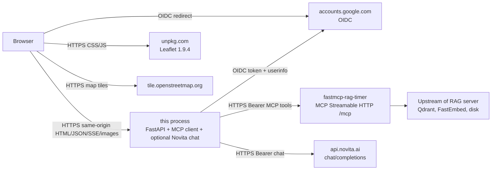
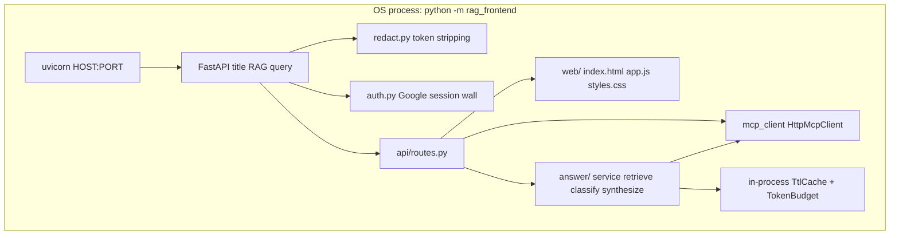
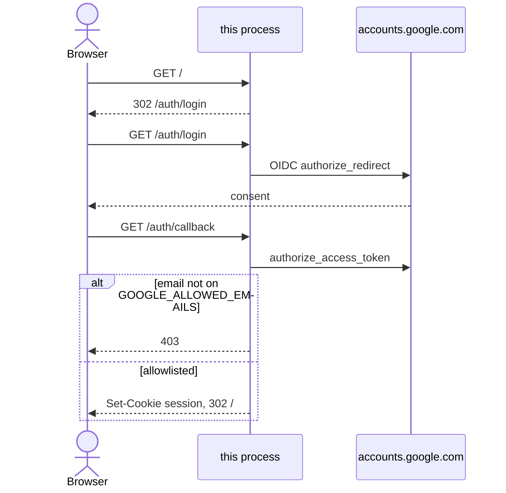
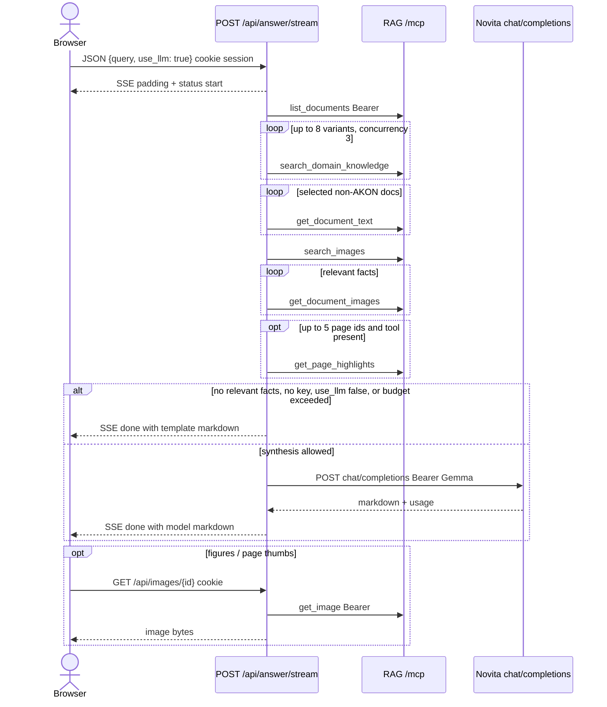

# Architecture

This document describes **fastmcp-rag-timer-frontend** as implemented in this repository.

**Sources of truth in this repo:** `src/rag_frontend/` (`config.py`, `auth.py`, `api/routes.py`, `mcp_client/`, `answer/`, `web/`, `redact.py`, `logging_setup.py`, `__main__.py`), `pyproject.toml`, `railpack.json`, `.env.example`, `tests/`, and `README.md`.

Facts about the sibling RAG server come from that repository ([fastmcp-rag-timer](https://github.com/mkrejp/fastmcp-rag-timer)) and are labeled **Backend repo**. Facts about the live Railway services are labeled **Live Railway (not in this repo)**. Everything else not present in those sources is labeled **Assumption**.

## purpose

This process is a one-page Czech query UI plus a server-side MCP client. A signed-in browser asks this app a question. This app retrieves from the RAG MCP server, optionally synthesizes a Czech answer with one Novita chat call, and proxies stored pictures so the browser never sees `MCP_API_TOKEN` or the Novita key.

It is not an MCP server. It does not ingest, delete, or administer the RAG datastore. Embeddings, Qdrant, and document storage stay on the RAG server.

## context



Relation to [fastmcp-rag-timer](https://github.com/mkrejp/fastmcp-rag-timer):

| Item | This repo | Backend |
| --- | --- | --- |
| Role | MCP **client** and web UI | MCP **server** and RAG store |
| Default MCP URL in this code | `https://rag-timer-00001-production.up.railway.app/mcp/` (`src/rag_frontend/config.py`, `.env.example`) | Serves Streamable HTTP at `/mcp` (**Backend repo**) |
| Auth this client sends | `Authorization: Bearer {MCP_API_TOKEN}` | Bearer `MCP_API_TOKEN` or fallback `RAG_API_TOKEN` (**Backend repo**) |
| Chat / completions | Yes, Novita Gemma, after retrieval | No chat client (**Backend repo**) |
| Search embeddings | None in this process | Local FastEmbed on the RAG server (**Backend repo**) |

The user-supplied production RAG URL `https://rag-timer-00001-production.up.railway.app/` matches the host in `DEFAULT_MCP_SERVER_URL`. This frontend does not call RAG REST routes (`/documents`, `/upload`, `/images/{doc_id}/{image_id}`). It only calls MCP tools on `{MCP_SERVER_URL}`.

**Live Railway (not in this repo):**

| Service | Project | Public URL | Notes |
| --- | --- | --- | --- |
| `fastmcp-rag-timer-frontend` | `perfect-eagerness` | `https://fastmcp-rag-timer-frontend-production.up.railway.app` | Domain port 8080, health check `GET /health`, Railpack, `python -m rag_frontend`, sleep enabled, 1 replica `europe-west4` |
| `rag-timer-00001` | `skillful-sparkle` | `https://rag-timer-00001-production.up.railway.app` | Domain port 8080, volume `/data`, sleep enabled |

`MCP_SERVER_URL` is **not** set on the frontend service, so the process uses the code default above. The two services are in different Railway projects. This app does not read `RAILWAY_PRIVATE_DOMAIN` or the sibling-service URL variables Railway injects. Outbound MCP therefore uses the public RAG hostname.

**Assumption:** Railway terminates TLS and forwards HTTP to the container listen port (`PORT`, commonly 8080). This repo does not terminate TLS.

## tech-stack

From `pyproject.toml`, `railpack.json`, and imports in `src/rag_frontend/`:

| Layer | Choice | Evidence |
| --- | --- | --- |
| Language | Python `>=3.11` | `pyproject.toml` |
| HTTP app | FastAPI `>=0.115`, Uvicorn `>=0.32` | `pyproject.toml`, `__main__.py` |
| MCP client | `mcp>=1.30,<2` Streamable HTTP | `mcp_client/session.py` |
| HTTP client | `httpx>=0.28` | MCP session and `answer/synthesize.py` |
| Google login | Authlib `>=1.3` + Starlette `SessionMiddleware` (`itsdangerous`) | `auth.py` |
| Frontend | One HTML page, vanilla JS, CSS | `web/index.html`, `web/app.js`, `web/styles.css` |
| Map | Leaflet 1.9.4 from unpkg, OSM tiles | `web/index.html`, `web/app.js` |
| Package/build | uv + hatchling | `pyproject.toml`, `uv.lock` |
| Deploy builder | Railpack (no Dockerfile in this repo) | `railpack.json` |
| Tests | pytest, pytest-mock | `pyproject.toml`, `tests/` |

There is no React/Next, no Node build, no Docker image in this repository, no compose file, and no GitHub Actions workflow.

## components



| Module | Path | Role |
| --- | --- | --- |
| Entrypoint | `src/rag_frontend/__main__.py` | `configure_logging()`, `load_settings()`, `uvicorn.run(create_app(settings), host, port)` |
| Settings | `src/rag_frontend/config.py` | Env-backed `Settings` |
| Auth | `src/rag_frontend/auth.py` | Session cookie, Google OIDC, login wall |
| HTTP API + page | `src/rag_frontend/api/routes.py` | Routes listed below; mounts `/static` |
| MCP client | `src/rag_frontend/mcp_client/session.py` | One Streamable HTTP session per tool call |
| MCP parsers | `src/rag_frontend/mcp_client/parse.py` | Search blocks, catalog JSON, image metadata |
| Answer pipeline | `src/rag_frontend/answer/` | Expand, retrieve, parse, classify, optional LLM, page previews |
| Redaction | `src/rag_frontend/redact.py` | Strip MCP token and LLM key from logs and text HTTP bodies |
| Logging | `src/rag_frontend/logging_setup.py` | INFO to stderr; quiet `httpx` / `httpcore` / `mcp` |
| Page | `src/rag_frontend/web/` | Single Czech UI |

### pages

There is one HTML document: `GET /` serves `web/index.html` (`lang="cs"`, title `RAG odpověď`). It posts to `/api/answer/stream`, renders markdown, figures, an optional Leaflet map, source rows or page thumbnails, and a live trace panel. It does not call `/api/search`, `/api/catalog`, or `/api/documents/*`.

`/static` serves the same `web/` directory (CSS, JS, and also `index.html` as a static file).

### HTTP routes

From `api/routes.py` and `auth.py`:

| Method | Path | Session | Behavior |
| --- | --- | --- | --- |
| `GET` | `/health` | No | `{"status":"ok"}` |
| `GET` | `/auth/login` | No | Redirect to Google, or 503 if OAuth env is missing |
| `GET` | `/auth/callback` | No | Allowlisted email → session cookie and 302 `/`; else 403 |
| `GET` | `/auth/logout` | No | Clear session, 302 `/auth/login` |
| `GET` | `/` | Yes | HTML page |
| `GET` | `/static/*` | No | Stylesheet, script, and other files under `web/` |
| `POST` | `/api/answer` | Yes | JSON Czech answer |
| `POST` | `/api/answer/stream` | Yes | Same answer as `text/event-stream` |
| `POST` | `/api/search` | Yes | Raw text search; optional `search_images` |
| `GET` | `/api/catalog` | Yes | `list_documents` plus first thumbnail id |
| `GET` | `/api/documents/{doc_id}/text` | Yes | `get_document_text` |
| `GET` | `/api/documents/{doc_id}/images` | Yes | `get_document_images` (hashes, paths, upstream URLs dropped) |
| `GET` | `/api/images/{image_id}` | Yes | Proxy `get_image` bytes |

Anonymous HTML (except `/health` and `/auth/*`) is 302 `/auth/login`. Anonymous `/api/*` is 401 `{"detail":"Sign in required."}`. FastAPI also exposes `/docs`, `/redoc`, and `/openapi.json`; those paths are not in the public set, so they follow the HTML login redirect.

`doc_id` must be a UUID. `image_id` must be 16 hex characters or `page:{uuid}:{1-based page}`.

### MCP tools this process calls

| Tool | Arguments this code sends | Callers |
| --- | --- | --- |
| `list_documents` | `{"since": ""}` | `/api/catalog`, answer retrieve |
| `search_domain_knowledge` | `{"query", "limit"}` (`limit` 1–20 on `/api/search`, `8` per answer variant) | `/api/search`, answer retrieve |
| `search_images` | `{"query", "limit", "hybrid": false}` | `/api/search` when `include_images`, answer `_attach_images` (`limit=5`) |
| `get_document_text` | `{"doc_id"}` | `/api/documents/{id}/text`, answer fulltext |
| `get_document_images` | `{"doc_id"}` | catalog thumbnails, document images route, answer `_attach_images` |
| `get_image` | `{"image_id"}` | `/api/images/{image_id}` (hex id or `page:{doc}:{page}`) |
| `get_page_highlights` | `{"doc_id", "page", "query"}` | answer page previews, up to 5 relevant facts |

Ingest, delete, locality-link, and figure-admin tools are not called.

If `get_page_highlights` returns unknown-tool text, this process remembers that and stops calling it (`answer/pages.py`).

**Backend repo:** `get_page_highlights` and `get_image` (including page ids) exist on the RAG server’s `rag/mcp_tools.py`. The backend architecture doc in that repo does not list every current tool; the tool module does.

## data-and-request-flows

### Google sign-in



Redirect URI is `{PUBLIC_BASE_URL}/auth/callback`. Scope is `openid email profile`. Cookie: Starlette session, `SameSite=Lax`, `https_only` when `PUBLIC_BASE_URL` starts with `https://`, `max_age` 12 hours.

### Answer (what the page actually does)



Retrieval steps (no model):

1. `expand_query` builds up to 8 variants from `answer/aliases.json` and a building-type suffix (`answer/expand.py`).
2. Cached `list_documents`, then parallel `search_domain_knowledge` with semaphore 3.
3. Fulltext for priority non-`akon_*` rows (search hits, `building-hints`, `obce.json`, then filename matches), cap 8 extra filename matches unless priority already exceeds 8 (`select_fulltext_rows`).
4. Parsers turn MCP text into `Fact` rows (building-hints, AKON, obce, plain passage).
5. `classify_facts` keeps at most 5 relevant objects; `obce.json` rows without a kraj prefix in the query are homonyms.
6. Image ids from `search_images` and `get_document_images`; page thumbs and highlight boxes when `page_image_id` is present.
7. At most one Novita call (`google/gemma-3-27b-it`, fallback `google/gemma-3-12b-it` only if the first call raises `httpx.HTTPError`). `max_tokens` is 600, `temperature` 0. Prompt JSON keeps ≤5 objects, text clipped to 280 characters, no raw OCR.

Empty query: 400, no outbound calls. Missing `MCP_API_TOKEN`: 503 `"MCP_API_TOKEN is not set."` Missing LLM key: template answer, `debug.reason` `chybí klíč`.

### Raw search API (not used by the current page)

`POST /api/search` calls `search_domain_knowledge` and, unless `include_images` is false, `search_images`. Default `limit` is 3, max 20. Picture-search failure does not drop text hits.

## state-management

No database and no volume in this repository.

| Store | Scope | TTL / reset | Code |
| --- | --- | --- | --- |
| Google session | Signed cookie | 12 hours | `auth.py` `SessionMiddleware` |
| Catalog | Process memory | `ANSWER_CACHE_TTL_SECONDS` (default 600) | `answer/retrieve.py` |
| Fulltext by `doc_id` | Process memory | same TTL | `answer/retrieve.py` |
| Answer payload | Process memory, key `{catalog_version}:{llm_flag}:{normalized query}` | same TTL | `answer/service.py` |
| Page highlights | Process memory | same TTL | `answer/pages.py` |
| Page-tool capability | Process memory | same TTL | `answer/pages.py` |
| Token budget | Process memory, per email + global, UTC day | restart or UTC midnight | `answer/cache.py` `TokenBudget` (40 calls or 50_000 tokens per user, 500_000 global) |
| Browser | DOM + `URL.createObjectURL` for images | page lifetime | `web/app.js` |

**Live Railway (not in this repo):** the frontend service has `sleepApplication: true` and no volume. Sleep or restart drops every in-memory cache and the daily budget.

There is no ingest webhook, so a catalog change is visible after TTL or process restart.

## configuration

Every environment variable `load_settings()` reads:

| Name | Default in code | Purpose |
| --- | --- | --- |
| `MCP_SERVER_URL` | `https://rag-timer-00001-production.up.railway.app/mcp/` | Streamable HTTP MCP endpoint. Trailing slash is the default. |
| `MCP_API_TOKEN` | empty | Bearer for every MCP call. Empty → query routes 503; HTML can still load after login. |
| `HOST` | `0.0.0.0` | Bind address |
| `PORT` | `8000` | Listen port. Railway injects `PORT` (see deploy). |
| `LLM_BASE_URL` | `https://api.novita.ai/openai/v1` | OpenAI-compatible chat base |
| `LLM_MODEL` | `google/gemma-3-27b-it` | Primary chat model |
| `LLM_MODEL_FALLBACK` | `google/gemma-3-12b-it` | Used only if the primary HTTP call fails |
| `NOVITA_LLM_API_KEY_GEMMA-3-27` | empty | Chat Bearer key. Hyphens are part of the name; shell `export` cannot set it. |
| `ANSWER_USE_LLM` | `true` (`1`/`true`/`yes`/`on`) | Process-wide synthesis switch |
| `ANSWER_CACHE_TTL_SECONDS` | `600` | In-memory TTLs |
| `GOOGLE_CLIENT_ID` | empty | OIDC client. Empty with empty secret → `/auth/login` 503 |
| `GOOGLE_CLIENT_SECRET` | empty | OIDC secret |
| `GOOGLE_ALLOWED_EMAILS` | empty tuple | Comma-separated, compared case-insensitively |
| `SESSION_SECRET` | `dev-session-change-me` if unset/blank | Cookie signing key |
| `PUBLIC_BASE_URL` | `http://127.0.0.1:8000` | OIDC redirect base and `https_only` cookie flag |

`.env.example` lists the same names. Application code does not read `RAILWAY_*` variables.

**Live Railway (not in this repo), frontend service custom variables present by name:** `GOOGLE_ALLOWED_EMAILS`, `GOOGLE_CLIENT_ID`, `GOOGLE_CLIENT_SECRET`, `MCP_API_TOKEN`, `NOVITA_LLM_API_KEY_GEMMA-3-27`, `PUBLIC_BASE_URL`, `SESSION_SECRET`. Not set there: `MCP_SERVER_URL`, `LLM_BASE_URL`, `LLM_MODEL`, `LLM_MODEL_FALLBACK`, `ANSWER_USE_LLM`, `ANSWER_CACHE_TTL_SECONDS`, `HOST` (code defaults apply). Values are not recorded in this document.

Budget caps (40 / 50_000 / 500_000) are constants in `TokenBudget`, not env vars.

## build-and-deploy

Local:

1. `uv sync`
2. Copy `.env.example` and set secrets in the environment (the Gemma key cannot be `export`ed in bash).
3. `uv run python -m rag_frontend`
4. Open `http://127.0.0.1:8000/` (or `PUBLIC_BASE_URL`).

`railpack.json`:

```json
{
  "$schema": "https://schema.railpack.com",
  "deploy": { "startCommand": "python -m rag_frontend" }
}
```

No Dockerfile, `railway.toml`, Procfile, or Nixpacks file. Hatch builds package `rag_frontend` and force-includes `answer/aliases.json`.

**Live Railway (not in this repo):** builder Railpack V3, start command `python -m rag_frontend`, health check path `/health`, public domain on port 8080, 4 CPU / 4 GB override, sleep on, one replica in `europe-west4-drams3a`. Verified: `GET https://fastmcp-rag-timer-frontend-production.up.railway.app/health` returns `{"status":"ok"}`; `/` is 302 `/auth/login`; `/api/catalog` is 401; `/static/styles.css` is 200 without a session.

**Assumption:** Railpack installs Python from `pyproject.toml` / `uv.lock` and runs the start command with Railway-injected `PORT`.

## security

| Topic | What the code does |
| --- | --- |
| Page and API auth | `LoginRequiredMiddleware`. `/health`, `/auth/*`, and `/static*` are public. Other HTML 302 to login. `/api/*` 401 without session. Email must stay on `GOOGLE_ALLOWED_EMAILS` or 403. |
| MCP token | Server-side only, `Authorization: Bearer` on the MCP HTTP client. Not sent to the browser. Query routes 503 if unset. |
| LLM key | Server-side only, Bearer on Novita POST. Missing key skips chat. |
| Redaction | `RedactTokenMiddleware` strips both secrets from text/JSON bodies. Log factory strips them from log messages. **Not** applied to `text/event-stream` or non-text (image) bodies. |
| CORS | None. The page is same-origin. |
| Cookie | `SameSite=Lax`; Secure when `PUBLIC_BASE_URL` is `https://`. |
| Catalog fields | `sha256`, disk paths, and upstream image URLs are dropped in parsers. |
| TLS | Not implemented in-process. |
| Test seam | `forced_user` on `create_app` bypasses Google. Production never passes it. |

The HTML page has no logout control, though `GET /auth/logout` exists.

**Assumption:** Google Cloud Console has authorized redirect `https://fastmcp-rag-timer-frontend-production.up.railway.app/auth/callback` (this URI is composed from `PUBLIC_BASE_URL` in code; the Console setting is not in this repo).

## observability

- Process logs at INFO on stderr; `httpx`, `httpcore`, and `mcp` loggers at WARNING so headers are not dumped (`logging_setup.py`).
- MCP logs tool name and argument count, not argument values or the bearer token (`session.py`).
- Answer `debug.trace` records step names, timings, hit counts, and clipped arguments. Keys named like `token` / `secret` / `authorization` / `prompt` are dropped (`answer/trace.py`).
- The page streams those steps over SSE and can copy the trace text.
- `GET /health` is liveness only. It does not probe MCP, Google, or Novita.
- No metrics, tracing SDK, or Railway tracing config in this repo. **Live Railway:** tracing off on the frontend service.

## limitations

1. **Single replica, in-memory cache and budget.** Restart or Railway sleep resets catalog/fulltext/answer caches and daily LLM caps.
2. **SSE bodies are not redacted.** `RedactTokenMiddleware` skips `text/event-stream`.
3. **`/static` is public**, including `/static/index.html`. API calls from that copy still need a session.
4. **No ingest/delete UI.** Write tools on the RAG server are unused.
5. **No Dockerfile / CI** in this repository.
6. **Page does not expose** catalog, raw search, `use_llm` toggle, or logout, even though those routes exist.
7. **AKON postcards are not fulltext-scanned** (`filename` starting `akon_`).
8. **`get_page_highlights` is optional.** If the tool is absent, previews fall back to text source rows.
9. **Cold MCP search** can take tens of seconds (RAG server sleep + embedding). The stream sends a padding comment so the first frame can flush.
10. **Default `SESSION_SECRET`** is a hardcoded development string when the env var is empty.
11. **Novita `max_tokens` is 600** in code. The design note `docs/PLAN-rag-answer.md` still says 400; the code wins.
12. **`docs/PLAN-rag-answer.md` is a design note**, not current-state architecture. Several of its requirements differ from the code (static files behind login, `/data/answer` volume, session LLM toggle). Use this file and [CONNECTIVITY.md](CONNECTIVITY.md) for the running system.

## procedures

### run — local page

1. `uv sync`
2. Set `MCP_API_TOKEN`, Google OAuth vars, `SESSION_SECRET`, and the Gemma key (Railway dashboard or another non-shell mechanism for `NOVITA_LLM_API_KEY_GEMMA-3-27`).
3. `uv run python -m rag_frontend`
4. Open `http://127.0.0.1:8000/` and complete Google sign-in.

### query — what the signed-in page shows

1. Submit a Czech question. The script always sends `{query, use_llm: true}` to `/api/answer/stream`.
2. The trace panel lists MCP and LLM steps as they start and finish.
3. The article shows `answer_markdown` (escaped HTML, `**bold**` and `http(s)` links only).
4. Figures load through `/api/images/{image_id}`. Up to five relevant PDF sources can show page thumbnails with highlight boxes.
5. GPS facts draw a Leaflet map (point vs centroid color).

## references

- [Documentation index](INDEX.md)
- [Connectivity](CONNECTIVITY.md)
- [Design note: cited Czech answer](PLAN-rag-answer.md)
- [fastmcp-rag-timer](https://github.com/mkrejp/fastmcp-rag-timer)
- [CursingStandards](https://github.com/mkrejp/CursingStandards)
