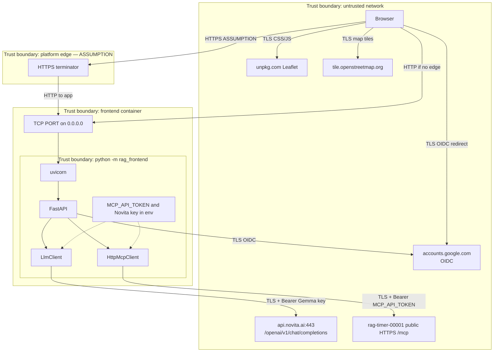
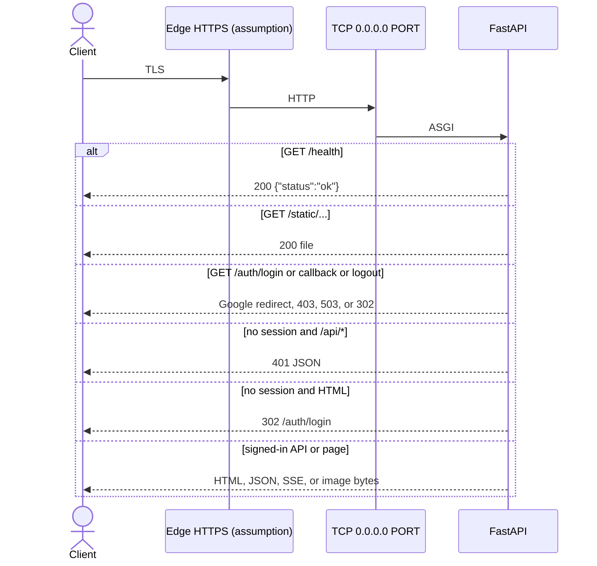

# Connectivity

This document inventories inbound, outbound, and in-process connections for **fastmcp-rag-timer-frontend**.

**Sources of truth in this repo:** `src/rag_frontend/config.py`, `auth.py`, `api/routes.py`, `mcp_client/session.py`, `answer/synthesize.py`, `answer/service.py`, `answer/retrieve.py`, `answer/pages.py`, `web/index.html`, `web/app.js`, `redact.py`, `railpack.json`, `.env.example`.

There is no reverse-proxy config, TLS cert, firewall, or compose network in this repository. Platform TLS and Railway routing are labeled **Live Railway (not in this repo)** or **Assumption**. Sibling RAG-server behavior is labeled **Backend repo**.

Related: [ARCHITECTURE.md](ARCHITECTURE.md).

## trust-boundaries



Trust notes from this code:

- The browser is untrusted. It never receives `MCP_API_TOKEN` or `NOVITA_LLM_API_KEY_GEMMA-3-27`.
- `/health`, `/auth/login`, `/auth/callback`, `/auth/logout`, and `/static*` are reachable without a session.
- `/` and `/api/*` require a Google session whose email is on `GOOGLE_ALLOWED_EMAILS`.
- MCP and Novita are only contacted after that wall, and only from this process.
- There is no CORS middleware. Cross-origin browsers are not granted API access by this app; a non-browser client that sends the session cookie could still call `/api/*`.
- This process binds `0.0.0.0`.
- The RAG server, Qdrant, and document disk are **outside** this trust boundary. This app reaches them only through MCP HTTPS.

**Live Railway (not in this repo):** frontend and RAG server are different Railway projects. MCP traffic uses the public hostname `rag-timer-00001-production.up.railway.app`, not a private mesh URL. This app does not read `RAILWAY_PRIVATE_DOMAIN` or `RAILWAY_SERVICE_*_URL`.

## inbound

```text
Client
  → (optional) HTTPS edge  [Assumption: Railway TLS]
    → TCP PORT on 0.0.0.0  [code default 8000; Railway commonly 8080]
      → uvicorn
        → FastAPI
          → RedactTokenMiddleware (text/JSON only)
          → SessionMiddleware + LoginRequiredMiddleware
            → /health, /auth/*, /static*  (public)
            → /  HTML page  (session)
            → /api/* JSON/SSE/images  (session)
```



Facts:

- Listen host `HOST` default `0.0.0.0`; port `int(os.environ.get("PORT", "8000"))`.
- Uvicorn is started without `proxy_headers` (unlike the RAG server). Cookie Secure is derived from `PUBLIC_BASE_URL`, not from `X-Forwarded-Proto`.
- No HTTP/2, gRPC, unix socket, or MCP server is started in this process.
- Health check path required by README and **Live Railway:** `GET /health`.
- **Live Railway:** public domain `https://fastmcp-rag-timer-frontend-production.up.railway.app` mapped to container port 8080. Verified 200 on `/health`, 302 on `/`, 401 on `/api/catalog`, 200 on `/static/styles.css`.

## outbound

This process opens outbound HTTP(S) for:

1. **MCP Streamable HTTP** to `MCP_SERVER_URL` (default `https://rag-timer-00001-production.up.railway.app/mcp/`). One `httpx.AsyncClient` per tool call, headers `Authorization: Bearer {MCP_API_TOKEN}`, timeout connect 30s / read 120s, `terminate_on_close=False` (`mcp_client/session.py`).
2. **Novita chat** `POST {LLM_BASE_URL}/chat/completions` (default `https://api.novita.ai/openai/v1/chat/completions`), Bearer Gemma key, timeout 60s (`answer/synthesize.py`). At most one successful call per answer; a second call only to `LLM_MODEL_FALLBACK` after `httpx.HTTPError`.
3. **Google OIDC** via Authlib: discovery `https://accounts.google.com/.well-known/openid-configuration`, then the authorization and token endpoints from that document (`auth.py`).

The **browser** (not this process) also fetches:

4. `https://unpkg.com/leaflet@1.9.4/dist/leaflet.css` and `leaflet.js`
5. `https://tile.openstreetmap.org/{z}/{x}/{y}.png` when the answer has GPS

No code in this repo talks to Qdrant, PostgreSQL, Redis, SMTP, Hugging Face, or TrailsAssemblage. Those belong to the RAG server or the browser.

Image **build-time** outbound is whatever Railpack uses (PyPI / uv). There is no Dockerfile to list base images.

**Live Railway (not in this repo):** a `GET` to `https://rag-timer-00001-production.up.railway.app/health` timed out during this documentation pass. The RAG service has sleep enabled; that timeout is consistent with a cold replica and is not proof the host is gone. The hostname matches `DEFAULT_MCP_SERVER_URL`.

## ports-protocols-auth

| Interface | Transport | Port | Auth in this repository |
| --- | --- | --- | --- |
| This app HTTP | HTTP/1.1 via uvicorn | **`PORT` (default 8000)/tcp** | Session on `/` and `/api/*`; none on `/health`, `/auth/*`, `/static*` |
| MCP client | HTTPS Streamable HTTP | 443 (default URL) | Outbound Bearer `MCP_API_TOKEN` |
| Novita chat | HTTPS | 443 | Outbound Bearer `NOVITA_LLM_API_KEY_GEMMA-3-27` |
| Google OIDC | HTTPS | 443 | OAuth client id/secret; session cookie inbound after callback |
| Leaflet / OSM | HTTPS from the browser | 443 | None |
| MCP stdio | — | — | Not started |
| CORS | — | — | Not configured |

**Backend repo:** `/mcp` requires Bearer `MCP_API_TOKEN` or fallback `RAG_API_TOKEN`, plus an optional Host allow-list. This client sends only the Bearer header. It does not set a custom `Host` allow-list header.

**Live Railway (not in this repo):** frontend custom env includes `MCP_API_TOKEN`. The RAG service lists `RAG_API_TOKEN` and does not list `MCP_API_TOKEN`. **Assumption:** the frontend bearer matches the token the RAG server currently accepts (`RAG_API_TOKEN` fallback if `MCP_API_TOKEN` is unset there). Values are not recorded here.

## connection-inventory

| Source | Target | Protocol / port | Auth | Purpose | Defined in |
| --- | --- | --- | --- | --- | --- |
| Browser | this app `GET /` | HTTP `PORT` | Google session cookie | Serve `index.html` | `api/routes.py` |
| Browser | this app `GET /static/*` | HTTP `PORT` | None | CSS, JS, static copy of the page | `api/routes.py` `StaticFiles` |
| Browser | this app `GET /health` | HTTP `PORT` | None | Liveness | `api/routes.py` |
| Browser | this app `/auth/login` `/auth/callback` `/auth/logout` | HTTP `PORT` | OIDC; logout clears cookie | Sign-in wall | `auth.py` |
| Browser | this app `POST /api/answer` | HTTP `PORT` | Session | JSON Czech answer | `api/routes.py` |
| Browser | this app `POST /api/answer/stream` | HTTP SSE `PORT` | Session | Live trace + answer | `api/routes.py`, `web/app.js` |
| Browser | this app `POST /api/search` | HTTP `PORT` | Session | Raw MCP search JSON (page does not call it) | `api/routes.py` |
| Browser | this app `GET /api/catalog` | HTTP `PORT` | Session | Catalog JSON (page does not call it) | `api/routes.py` |
| Browser | this app `GET /api/documents/{doc_id}/text` | HTTP `PORT` | Session | Fulltext JSON | `api/routes.py` |
| Browser | this app `GET /api/documents/{doc_id}/images` | HTTP `PORT` | Session | Image metadata JSON | `api/routes.py` |
| Browser | this app `GET /api/images/{image_id}` | HTTP `PORT` | Session | Proxy picture or page render | `api/routes.py`, `web/app.js` |
| Railway healthcheck | this app `GET /health` | HTTP `PORT` | None | Deploy liveness | README; **Live Railway** `healthcheckPath` |
| Platform edge | uvicorn | HTTP `PORT` | None at app | TLS termination | **Assumption** |
| `HttpMcpClient` | `{MCP_SERVER_URL}` default `https://rag-timer-00001-production.up.railway.app/mcp/` | HTTPS 443 Streamable HTTP | Bearer `MCP_API_TOKEN` | `list_documents`, `search_domain_knowledge`, `search_images`, `get_document_text`, `get_document_images`, `get_image`, `get_page_highlights` | `config.py`, `mcp_client/session.py`, `api/routes.py`, `answer/retrieve.py`, `answer/service.py`, `answer/pages.py` |
| `LlmClient` | `{LLM_BASE_URL}/chat/completions` default `https://api.novita.ai/openai/v1/chat/completions` | HTTPS 443 | Bearer `NOVITA_LLM_API_KEY_GEMMA-3-27` | One synthesis call | `answer/synthesize.py` |
| Authlib Google client | `https://accounts.google.com/.well-known/openid-configuration` and discovered token/auth URLs | HTTPS 443 | OAuth client id/secret | Sign-in | `auth.py` |
| Browser | Google authorization endpoint | HTTPS 443 | User Google account | Consent | `auth.py`, `web` redirect |
| Browser | `https://unpkg.com/leaflet@1.9.4/...` | HTTPS 443 | None | Map library | `web/index.html` |
| Browser | `https://tile.openstreetmap.org/{z}/{x}/{y}.png` | HTTPS 443 | None | Map tiles | `web/app.js` |
| In-process caches | RAM | n/a | n/a | Catalog, fulltext, answers, highlights, LLM budget | `answer/cache.py`, `answer/retrieve.py`, `answer/pages.py`, `answer/service.py` |

## mcp-tool-calls

Each MCP call is a new Streamable HTTP session (`initialize` + `tools/call`). Auth is always Bearer `MCP_API_TOKEN`.

| Tool | Typical arguments | When |
| --- | --- | --- |
| `list_documents` | `since=""` | Catalog route; start of every answer retrieve |
| `search_domain_knowledge` | `query`, `limit` | Search route; each answer variant (`limit=8`) |
| `search_images` | `query`, `limit`, `hybrid=false` | Search route if `include_images`; answer attach-images (`limit=5`) |
| `get_document_text` | `doc_id` | Document text route; answer fulltext for selected non-AKON docs |
| `get_document_images` | `doc_id` | Catalog thumbnail, document images route, answer attach-images |
| `get_image` | `image_id` | Image proxy (16-hex id or `page:{uuid}:{page}`) |
| `get_page_highlights` | `doc_id`, `page`, `query` | Up to five relevant PDF facts with a page id |

Not called: `ingest_text`, `get_document_chunks`, `get_page_image` (page bytes go through `get_image`), locality-link tools, figure-admin tools, `sync_links_to_trails`.

## data-crossing-boundaries

| Flow | Data |
| --- | --- |
| Inbound `/api/answer*` | User question text; optional `use_llm`. Response: Czech markdown, fact cards, image ids, debug trace (no secrets by design; SSE not redacted). |
| Inbound `/api/search` | Question + limit; MCP search text shaped into passages. |
| Inbound `/api/images/*` | Image bytes from MCP `ImageContent`, or 404/413/502. Binary bodies are not token-stripped. |
| Outbound MCP | Tool names and arguments (queries, doc ids, image ids). Bearer token. Returned document text, search blocks, image bytes. |
| Outbound Novita | System prompt + compact JSON of up to 5 objects (no raw OCR). Bearer Gemma key. |
| Outbound Google | OAuth code exchange; email stored in the session cookie payload. |
| Browser Leaflet/OSM | Map tile requests; GPS coordinates from facts. |

No encryption-at-rest is configured. Secrets live in process environment variables.

## discrepancies-and-risks

These are observable from the code and live platform, not a backlog.

| Item | Risk |
| --- | --- |
| Frontend and RAG server in different Railway projects | MCP always traverses the public internet to `rag-timer-00001-production.up.railway.app`. |
| Both services have sleep enabled (**Live Railway**) | First request after idle pays RAG cold start; in-memory budget/cache on this app reset. |
| `MCP_SERVER_URL` unset on Railway | Hostname is the code default. Changing the RAG domain without setting the env var or changing `config.py` would miss the server. |
| SSE skip in `redact.py` | If a secret appeared in a streamed event, it would not be stripped. Trace cleaning drops secret-like **keys**, not values inside other fields. |
| Public `/static/index.html` | The UI markup is readable without login. Datastore rows are not, unless a session cookie is sent. |
| Image proxy 413 | MCP inline limit is 5 MiB on the RAG server (**Backend repo**). Large pictures become 413 JSON, not a redirected RAG `/images/...` fetch (that REST URL needs the same bearer this app is hiding). |
| No CORS | Fine for same-origin. Not a substitute for CSRF defenses beyond `SameSite=Lax`. |
| Default `SESSION_SECRET` | Empty env signs cookies with `dev-session-change-me`. **Live Railway** does set `SESSION_SECRET`. |

## references

- [Architecture](ARCHITECTURE.md)
- [Index](INDEX.md)
- [fastmcp-rag-timer connectivity](https://github.com/mkrejp/fastmcp-rag-timer/blob/main/docs/CONNECTIVITY.md) (**Backend repo**)
